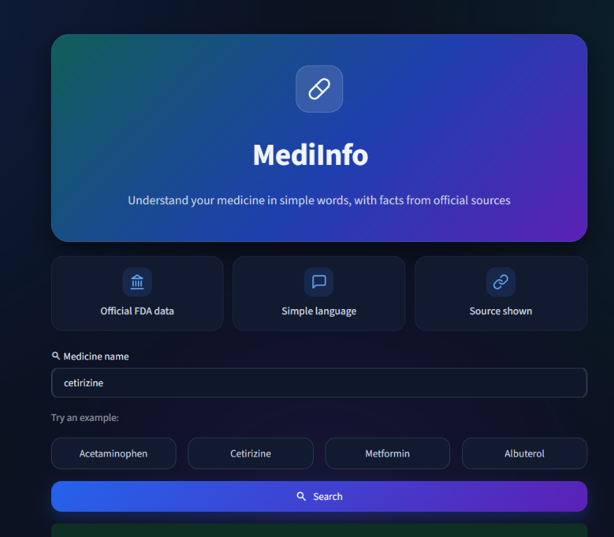
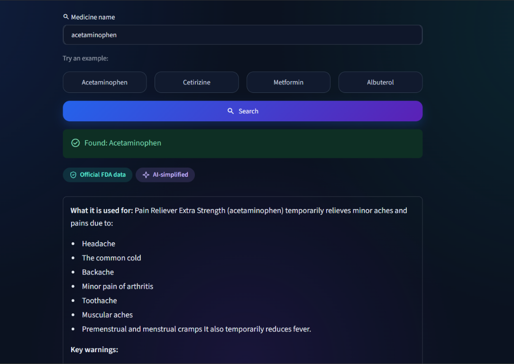
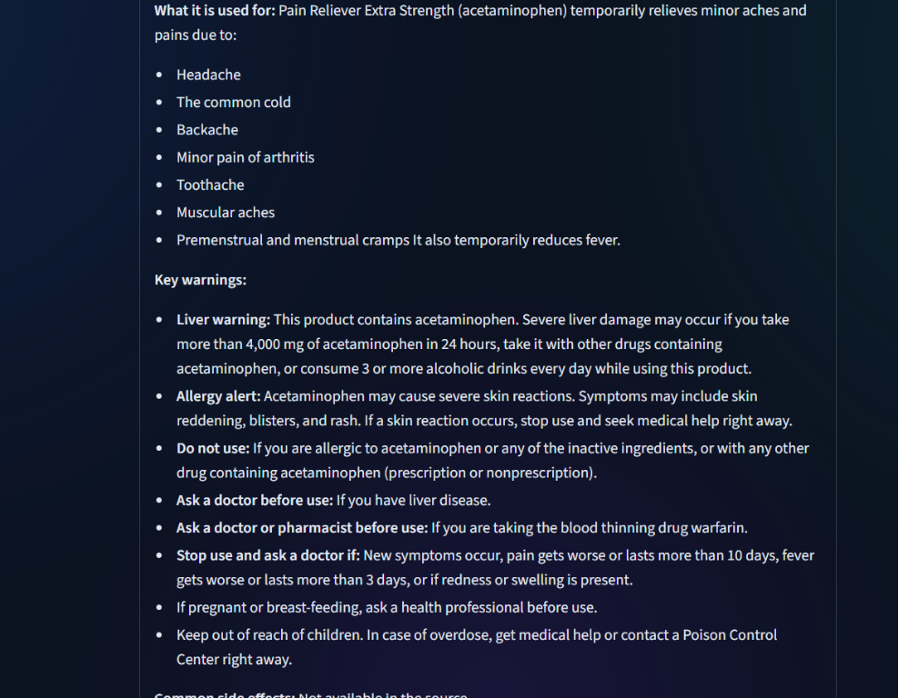

# MediInfo

MediInfo helps make medicine label information easier to understand. It retrieves U.S. drug-label information from the openFDA API and uses Google Gemini to explain the returned information in plain language.

## Screenshots

### Search for a medicine

### Medicine information

### Warnings

## Features

- Search medicine labels by generic or brand name.
- Display uses, warnings, side effects, and interactions from openFDA.
- Summarize label information in simpler language with Gemini.
- Show the data source alongside the results.

## Medical information notice

MediInfo is for general informational purposes only. It does not provide medical advice or dosing recommendations. Always consult a doctor or pharmacist before using a medicine, and check the official product label for current information.
